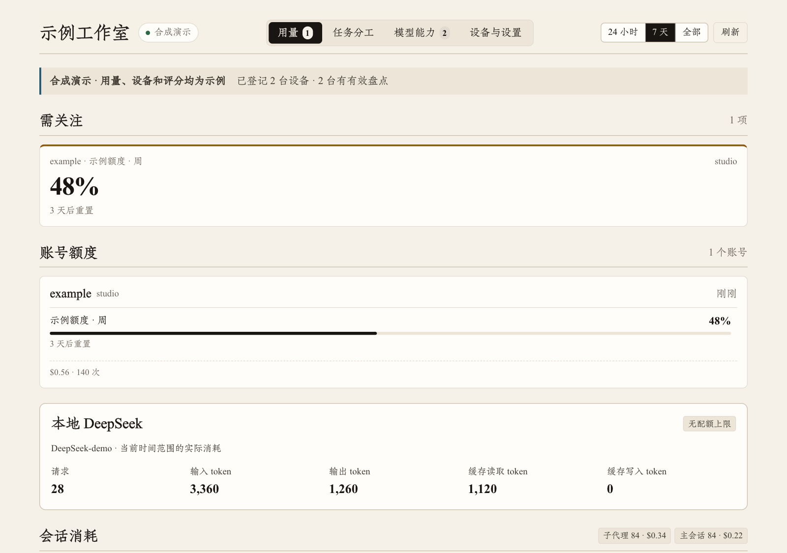
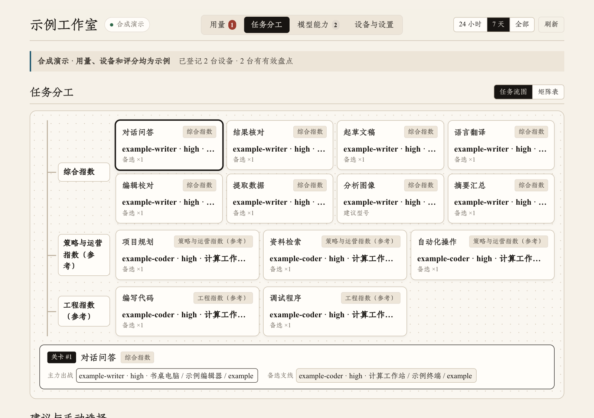
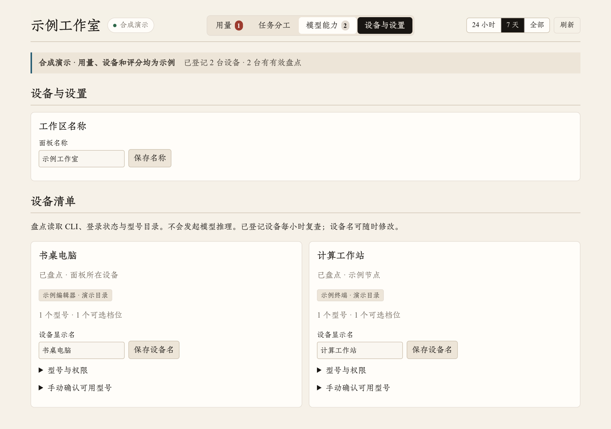
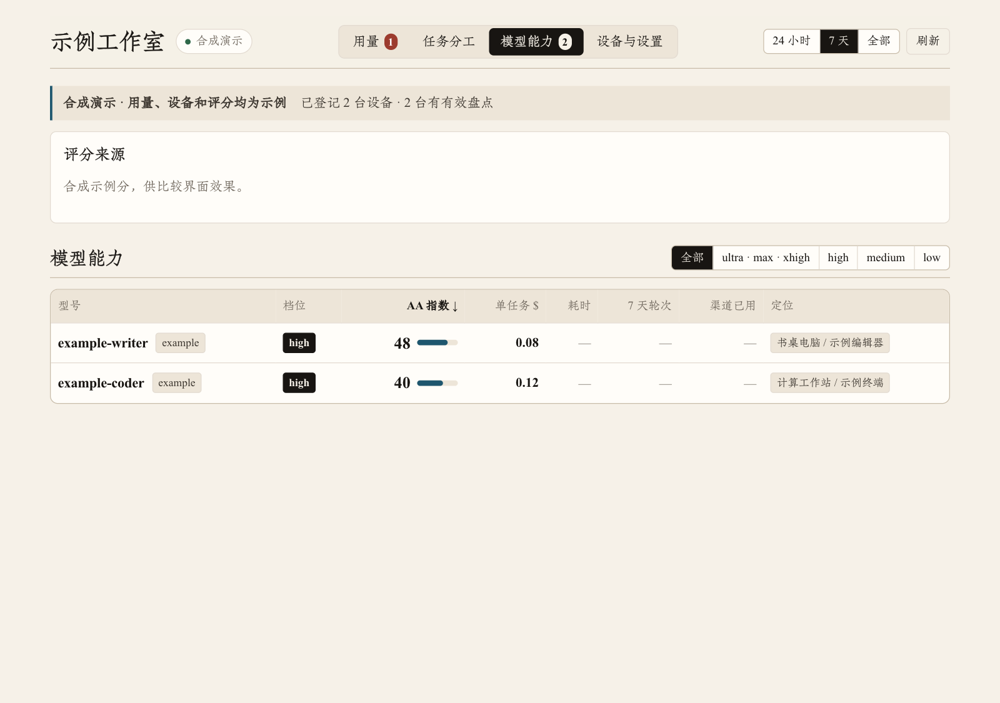
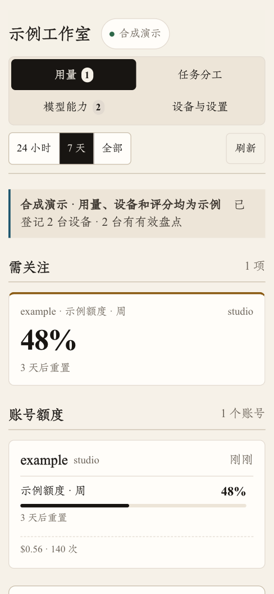

[简体中文](README.md) · **English**

# Model Usage Desk

Check account usage, compare models and choose which device should handle a task. Hosted accounts show quota windows. Local DeepSeek usage has its own counters for requests, input, output and cached tokens. The interface is in Chinese.



## Highlights

- **Try it offline.** Extract the ZIP and open `index.html`. The demo needs no installation, account or API key.
- **Track quotas and consumption separately.** Subscription accounts show quota windows and reset times. Local DeepSeek shows request counts and input, output and cached token counts.
- **Find models by device.** Name the dashboard and each device, then see which tools and models are available locally and on the SSH hosts you register.
- **Choose how to assign work.** The dashboard recommends a first choice and alternatives for 13 task types using available devices, models and ratings. Pin a model on a particular device or exclude it from recommendations.
- **Keep ratings up to date.** Enable sync with your own Artificial Analysis key to check for updates every 24 hours or refresh manually. Models without a matching rating keep a blank score.
- **Share a read-only summary.** Trusted readers can view usage through a separate password-protected port. Only the local management interface can change settings or start collection.
- **Choose when to connect real data.** The public demo and screenshots use synthetic data. Cloning the repository does not scan your network. Local usage collection requires both a startup flag and consent in the interface.
- **Verify the results yourself.** Rebuild the demo snapshots from source and run `python3 test_demo.py` to check recommendations and sharing permissions. With Chrome and Node.js installed, the tests also exercise login in a real browser.

## Try the demo

[Download the source ZIP](https://github.com/ozrwayne/model-usage-desk/archive/refs/heads/main.zip), extract it and open `index.html`. The read-only demo works offline without an account or API key. The screenshots and static page use generated sample data.

To rename a device or pin a model, run this in the extracted directory (Python 3.10+, standard library only):

```sh
python3 server.py --demo --no-open
```

On the same computer, open the loopback URL printed in the terminal (normally `http://127.0.0.1:3927`). Switch between 24 hours, 7 days and all records in **用量**. The status button opens the account sampling history.

## Devices and task recommendations

1. **设备与设置 — Devices and settings.** Rename the workspace or either sample device. For your own environment, run `python3 server.py --no-open`, then select **同意并盘点本机** to inventory this computer. Cloning or starting the app does not discover LAN devices automatically.
2. **添加设备 — Add a device.** Configure SSH key access and verify the host fingerprint first. Register the SSH alias to inventory supported CLIs and available model catalogs on that device. You can also register a model you have verified yourself.
3. **任务分工 — Task recommendations.** Select a task in the flow diagram, or use the matrix to compare 13 task types. Pin a device/model pair or restore the automatic recommendation. The dashboard never dispatches jobs.



<details><summary>Device and workspace settings</summary>



</details>

## Capabilities and usage sources

**模型能力 — Capabilities** lists discovered models. To update external ratings, set `AA_API_KEY` in the server environment and enable sync on this tab. The app retrieves the public [Artificial Analysis catalog](https://artificialanalysis.ai/data-api/docs/reference), checks every 24 hours when enabled and supports manual refresh. Unmatched scores stay blank; demo scores are fictional. See the [AA terms](https://artificialanalysis.ai/documentation).



**Actual usage** is opt-in: run `python3 server.py --collect-usage --no-open` and authorize local inventory in the UI. Collection depends on the host's OMP accounts, provider endpoints and available usage ledger. Set `PI_CONFIG_DIR` to use a different OMP configuration. Remote model inventory and host usage have separate scopes. For supported local DeepSeek channels with ledger entries, the dashboard shows consumption without a quota ceiling.

When live collection is enabled, the server reads local OMP login tokens to query the respective providers. The Google and xAI adapters use client-facing endpoints; check the provider terms before use, and expect these interfaces to change. The synthetic demo needs no token. Self-hosted DeepSeek uses the `local-deepseek` provider by default; set `USAGE_LOCAL_DEEPSEEK_PROVIDERS` to a comma-separated list of your own provider labels if needed.

<details><summary>Mobile usage view</summary>



</details>

## Storage and rollback

The service listens on loopback by default. Keep the management port local. A separate optional password-protected sharing port is for trusted readers; live statistics, identifiers and model selections can still identify a user. Use `--demo` for public presentations.

State lives in `$XDG_STATE_HOME/usage-dashboard` or `~/.local/state/usage-dashboard` by default. Set `USAGE_DATA_DIR` for a separate workspace and `USAGE_AUTH_DIR` for a separate credentials directory. Stop the process before renaming a state directory as a backup. To roll back, stop the new instance and point it at the backup. See [data flow and permissions (Chinese)](ARCHITECTURE.md).

### Password-protected read-only sharing

```sh
python3 server.py --set-password
python3 server.py --demo --port 3927 --public-port 3928 --no-open
```

Open `http://127.0.0.1:3928` locally and enter the password. The management port is `3927`. Sharing is off by default. Setting a new password rotates the session secret and invalidates existing sessions.

For other devices, place an HTTPS reverse proxy on the same machine. Add `--public-origin https://desk.example.org` (use your own hostname). Proxy only to `127.0.0.1:3928`, preserving the external Host and non-default port. Terminate TLS at the proxy and redirect external HTTP to HTTPS. Never proxy the management port. The service checks Host against the configured origin and always sets Secure cookies in HTTPS sharing mode. It does not trust forwarded protocol, identity or client-IP headers. The backend limits failed logins by the directly connected peer (five failures per 15 minutes); users behind one proxy share that budget. Configure per-client throttling at the proxy if needed.

The shared view contains numbered accounts, quota windows, model/provider labels and usage statistics. Readers cannot change settings or trigger collection. Labels, timestamps and statistics can still reveal usage patterns: share live data only with trusted readers and use `--demo` for public presentations. Missing credentials or conflicting ports prevent startup.

### Optional local integrations

- Set `OMP_BIN` to select the OMP usage command. If `omp-multi-auth` is installed under the OMP configuration, usage and token queries load that local extension. Use a trusted installation. Collection writes a `当前状态.md` status report in the state directory. Pass `--no-notify` to disable local macOS quota notifications.

## Verification and licenses

`python3 test_demo.py` checks fixture reproducibility, recommendations and access control. Browser checks also require Chrome and Node.js. `python3 build_demo.py` recreates the three public snapshots from constants.

Code: [MIT](LICENSE). The bundled [Zhuque Fangsong](https://github.com/TrionesType/zhuque) typeface is distributed under [SIL OFL 1.1](assets/OFL-1.1.txt). Provider names and marks identify their respective services.
