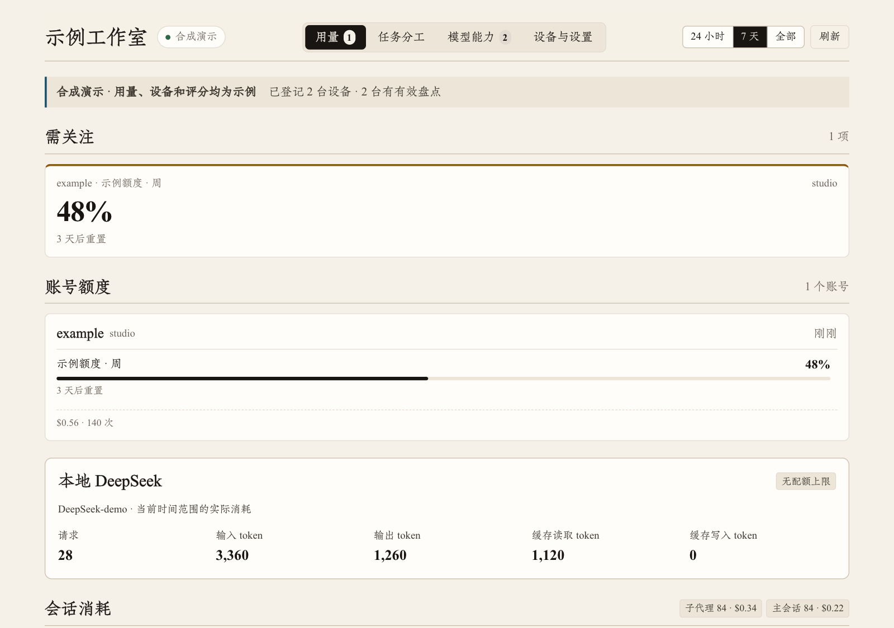
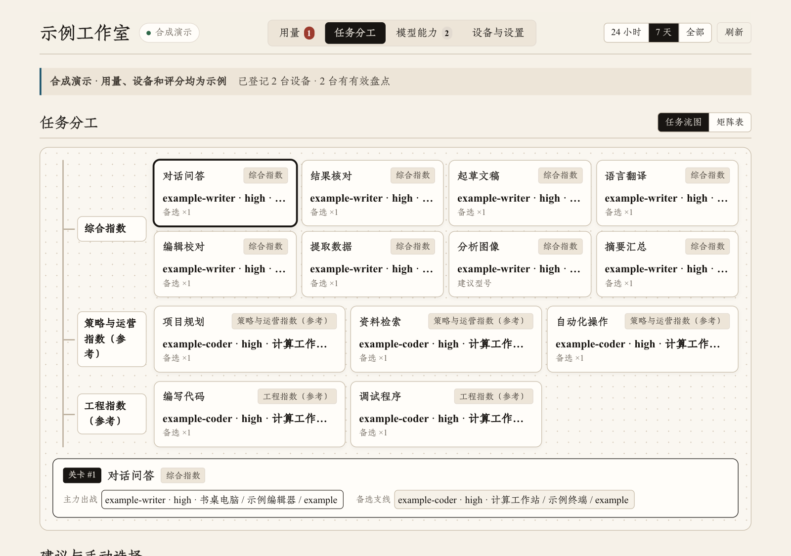
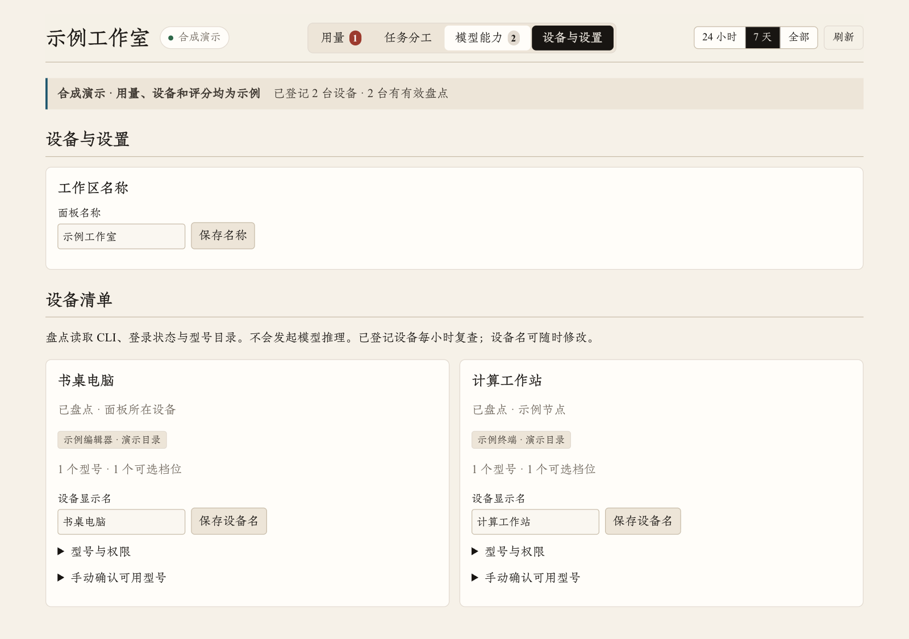
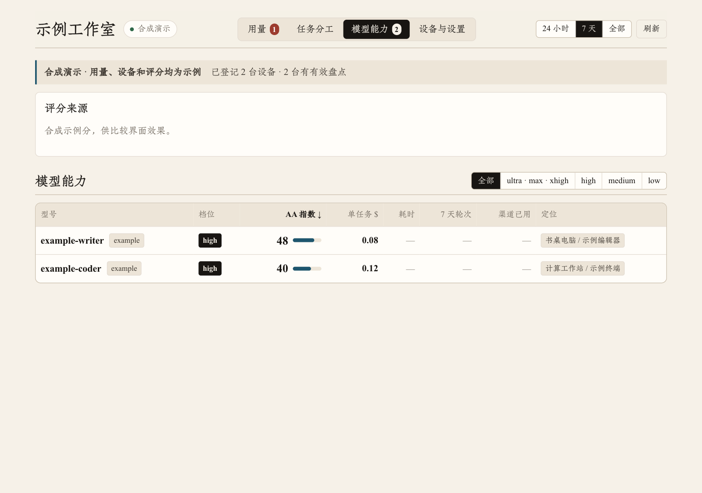
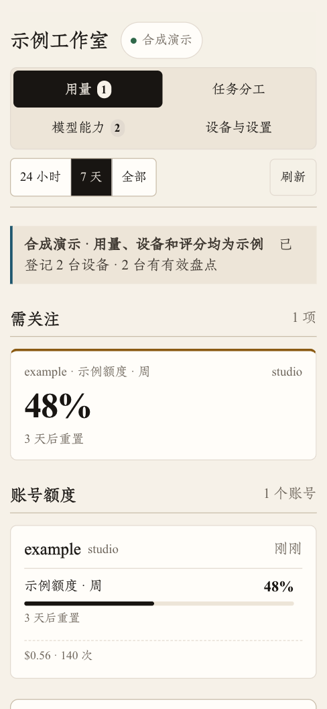

**简体中文** · [English](README.en.md)

# Model Usage Desk

在一个本地面板里看模型账号的用量、比较模型能力，并按设备选择适合某项任务的模型。托管账号显示额度窗口；本地 DeepSeek 单列请求、输入、输出和缓存 token。



## 项目特点

- **离线试用**：解压后打开 `index.html` 就能看演示，无需安装依赖、注册账号或配置密钥。
- **分开看额度和消耗**：订阅账号显示额度窗口和重置时间；本地 DeepSeek 显示请求次数，以及输入、输出和缓存 token 数。
- **按设备找模型**：可以给面板和设备命名，在同一页查看本机和已登记 SSH 设备上有哪些工具、哪些模型可用。
- **自己决定任务分工**：面板按可用设备、模型和评分，为 13 类任务推荐首选和备选。你可以固定某台设备上的模型，也可以把模型排除在推荐之外。
- **更新模型评分**：用自己的 Artificial Analysis 密钥启用同步后，面板每 24 小时检查一次，也支持手动刷新。没有匹配评分的型号会留空。
- **只读分享用量**：可信读者通过独立的密码入口查看摘要。修改配置和启动采集的权限留在本机管理端。
- **自己决定何时接入真实数据**：公开演示和截图使用合成数据。克隆仓库不会扫描局域网；采集本机用量需要显式启用并在界面授权。
- **在本机复验**：可以从源码重建演示快照，运行 `python3 test_demo.py` 检查推荐和共享权限；安装 Chrome 和 Node.js 后，还能验证实际的浏览器登录流程。

## 先看演示

[下载源码 ZIP](https://github.com/ozrwayne/model-usage-desk/archive/refs/heads/main.zip)，解压后双击 `index.html`。静态演示可离线浏览，无需账号或密钥。截图与静态页均使用生成的示例数据。

要试改名和固定模型，在解压目录运行（Python 3.10+，仅用标准库）：

```sh
python3 server.py --demo --no-open
```

在运行服务的电脑上打开终端打印的地址，默认是 `http://127.0.0.1:3927`。用量页可以切换 **24 小时、7 天、全部**；点击页首状态可展开账号采样记录。

## 设备与分工

1. **设备与设置**：给面板和设备改显示名。示例工作室有两台设备。接入自己的环境时，运行 `python3 server.py --no-open`，在页面点「同意并盘点本机」。克隆仓库和首次启动都不会自动搜索局域网。
2. **添加设备**：先配置 SSH 密钥并核对主机指纹，再自行登记 SSH 别名。盘点读取相应设备上支持的 CLI 与型号目录；也可手动登记自己确认可用的型号。
3. **任务分工**：在任务流图点一项任务查看首选和备选，或切到矩阵表比较 13 类任务。可以固定某台设备和型号，也可以恢复自动建议。面板提供建议，任务由你派发。



<details><summary>设备改名与盘点界面</summary>



</details>

## 能力与用量来源

**模型能力**按盘点结果列出型号。要刷新外部评分，在启动进程的环境中设置自己的 `AA_API_KEY`，再在「模型能力」启用同步。程序从 [Artificial Analysis](https://artificialanalysis.ai/data-api/docs/reference) 获取公开目录，启用后每 24 小时检查，也可手动刷新。未匹配的评分留空；演示分数为虚构数据。评分数据使用受 [AA 条款](https://artificialanalysis.ai/documentation)约束。



**实际用量**另行开启：`python3 server.py --collect-usage --no-open`，并在界面授权盘点。采集依赖本机 OMP 的账号、服务商接口及可用账本；可用 `PI_CONFIG_DIR` 指向自己的 OMP 配置。远端设备的型号目录与主机的用量统计分别展示。本地 DeepSeek 渠道有用量记录时显示实际消耗，不估算剩余额度。

开启实况采集后，服务会读取本机 OMP 登录令牌，向相应提供商查询额度。Google 和 xAI 适配器使用客户端接口；使用前请核对提供商条款，接口也可能变更。合成演示无需令牌。自托管 DeepSeek 默认识别 `local-deepseek`；渠道名由自己定义时，用 `USAGE_LOCAL_DEEPSEEK_PROVIDERS` 指定，以逗号分隔。

<details><summary>手机宽度的用量页</summary>



</details>

## 数据与回退

默认服务仅监听本机回环。账户记录、设备别名、真实统计和操作日志留在自己的环境中；请勿对外转发管理端口。可选密码共享端口供可信读者使用，实况的型号、统计和标识仍可能辨认用户。对外演示请用 `--demo`。

默认状态目录为 `$XDG_STATE_HOME/usage-dashboard`，未设置时为 `~/.local/state/usage-dashboard`。`USAGE_DATA_DIR` 可隔离工作区，`USAGE_AUTH_DIR` 可隔离凭证目录。停止进程后可将状态目录改名备份；要回退，停止新实例并指回备份。详见[数据流与权限](ARCHITECTURE.md)。

### 密码只读共享

```sh
python3 server.py --set-password
python3 server.py --demo --port 3927 --public-port 3928 --no-open
```

本机访问 `http://127.0.0.1:3928` 并输入密码。管理端口为 `3927`；共享默认关闭。`--set-password` 会轮换会话密钥，旧会话随即失效。

跨设备共享时，在同机部署 HTTPS 反向代理。启动时追加 `--public-origin https://desk.example.org`（替换为自己的域名）；代理只转发至 `127.0.0.1:3928`，上游 `Host` 保留这个外部域名及非默认端口。TLS 在代理终止，公网 HTTP 应重定向至 HTTPS。不要转发管理端口。应用按配置校验 Host，在 HTTPS 共享模式下总是设置 Secure Cookie，不采信转发头中的协议、身份或客户 IP。后端按直连地址限流（15 分钟内 5 次密码错误）；多个读者经同一代理共用该限额，可在代理另设按客户端限流。

共享页只展示编号账号、额度窗口、模型与渠道名和用量统计。读者无法修改配置或触发采集。模型名、渠道自定义标签、统计和时间仍可能透露使用情况，请只给可信读者；公开演示使用 `--demo`。端口冲突或尚未设置密码时，共享启动会直接报错。

### 可选本机功能

- OMP 用量命令可用 `OMP_BIN` 指定。若 OMP 配置下已安装 `omp-multi-auth` 扩展，用量和令牌查询会加载该本地扩展；请只使用自己信任的安装。采集会在状态目录写入 `当前状态.md`；macOS 可发本地额度通知，`--no-notify` 关闭通知。

## 验证与许可

`python3 test_demo.py` 验证演示再现性、分工选择和访问控制；浏览器交互检查需要 Chrome 和 Node.js。`python3 build_demo.py` 仅从代码常量重建三个时间范围的公开快照。

代码采用 [MIT](LICENSE)。感谢[朱雀仿宋](https://github.com/TrionesType/zhuque)，随包字体使用 [SIL OFL 1.1](assets/OFL-1.1.txt)。厂商名称和标记用于识别对应服务。
